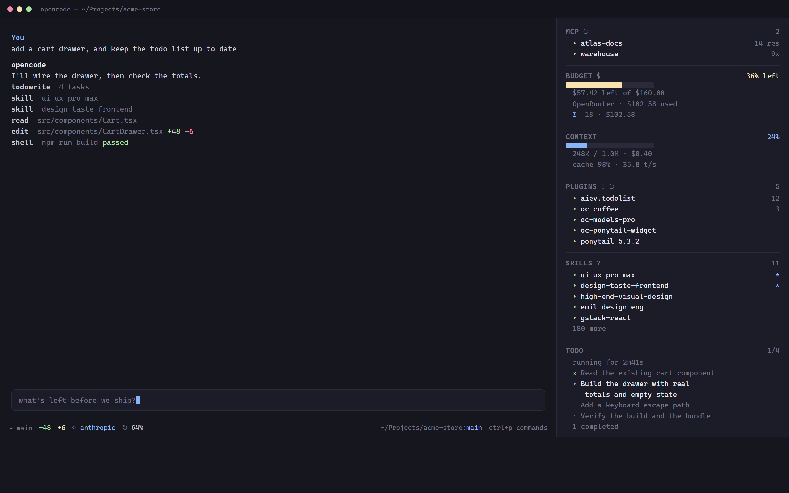

# opencode-sidebar-tui

[](https://github.com/r00tb3/opencode-sidebar-tui/actions/workflows/ci.yml)
[](https://www.npmjs.com/package/opencode-sidebar-tui)
[](LICENSE)

A live-status sidebar and prompt footer for **OpenCode V2**.

One ordered panel shows what the session is actually doing — MCP servers,
provider budget, context usage, loaded plugins, skills in use, and the todo
list — while the footer carries git state, provider spend and the project path.



## What it does

**Sidebar** — six sections in a fixed order (MCP, Budget, Context, Plugins,
Skills, Todo). Section headers are quiet and uppercase, values carry the
colour, and every row has one consistent marker: `•` active, `·` idle, `x`
done, `*` pinned.

- **MCP** — servers with a health dot, plus resource and call counts.
- **Budget** — remaining provider budget with a bar, the exact figures, and
  the cross-session spend total behind `Σ`.
- **Context** — window usage, token counts, session cost, cache rate and
  tokens per second.
- **Plugins** — active plugins, versions, and how often each one's tools ran.
- **Skills** — used skills rise to the top and light up; pin the ones you keep
  reaching for. Usage updates as the model loads a skill, not at the end of
  the turn.
- **Todo** — tasks from the session's todo tool, with progress, elapsed time,
  and wrapped task text so nothing is cut off.

**Footer** — git branch and change counts, the provider serving the current
model (click it to switch), remaining provider budget, and the project path.

**Optional server plugin** — a todo tool plus an auto-todo instruction that
nudges the model to keep a short task list for multi-step work.

## Requirements

- OpenCode **V2** (developed against `2.2.0`).
- The TUI plugin API exposes `sidebar.content`, `sidebar.footer` and
  `prompt.footer.status`; older builds without those slots will not render it.
- Windows is the tested platform. The budget panels read
  `~/.local/share/opencode` for the auth file and database, which is the layout
  on the tested install; other platforms are untested.
- `git` on `PATH` for the footer git segment.

## Install

### From npm

```bash
opencode plugin add opencode-sidebar-tui
```

That registers the optional server half (the todo tool). The sidebar and footer
are the TUI half, and OpenCode keeps those in a separate list — add the package
name to `~/.config/opencode/cli.json`:

```json
{
  "plugins": ["opencode-sidebar-tui"]
}
```

Then restart OpenCode. Verify both halves with `opencode plugin list`, which
should print `opencode-sidebar-tui` with the installed version.

### From a local checkout

Point OpenCode at the directory in both configuration files, then restart:

`~/.config/opencode/cli.json` (TUI half):

```json
{
  "plugins": ["C:/path/to/opencode-sidebar-tui"]
}
```

`~/.config/opencode/opencode.jsonc` (server half, optional):

```jsonc
{
  "plugin": ["C:/path/to/opencode-sidebar-tui"]
}
```

Do not load two copies of this plugin, or the todo tools and the sidebar will
both be registered twice.

## Use

| Action | How |
| --- | --- |
| Sidebar settings | `/sidebar` |
| Cross-session spend | `/usage` |
| Footer icon legend | `/footer-key` |
| Toggle a section | click its header |
| Pin a skill | click the skill row |
| Switch provider | click the `◇` segment in the footer |

Sections remember their collapsed state, pinned skills and the completed-todo
filter under plugin id `oc-sidebar.tui` and storage key `oc-sidebar.settings`,
so the layout survives restarts and upgrades.

## Troubleshooting

**Sidebar is empty.** The TUI half ships as TypeScript source and OpenCode
transpiles it at startup. If rows never populate, confirm the host loaded this
package's `tui.tsx` (see `~/.local/share/opencode/log/opencode.log`) and not a
prebuilt bundle from an older install.

**Sidebar is missing entirely.** OpenCode hides the right pane when the session
area is narrow. Widen the terminal or hide/show the sidebar with the leader key
then `b`.

**Skills never light up.** Skill usage is read from session messages. If a call
does not appear, the skill's tool name is something other than `skill` or
`*​.skill` on your build.

**Budget shows nothing.** The budget segments need provider credentials for
OpenRouter or OpenCode Zen; other providers show no budget row.

## Development

There is no build step for the TUI. OpenCode loads `src/tui.tsx` and transpiles
it with its own Solid transform, which is required: bundling the TUI ahead of
time collapses reactive children into one eager render and leaves every list
empty. Keep the TUI as source.

```bash
npm run pack:check                              # what would be published
bun build --no-bundle src/tui.tsx --outdir .check   # syntax check
npm pack                                        # installable tarball
```

Layout:

```
src/tui.tsx            plugin entry, registers the sidebar and footer
src/sidebar/tui.tsx    sidebar sections, indexes for skills/plugins/todos
src/sidebar/todos.js   todo normalisation
src/sidebar/timing.js  per-task timing
src/footer/tui.tsx     footer segments, git state, provider budget
src/server/            optional server half (todo tool, auto-todo)
tools/                 local maintenance scripts
```

## Releasing

```bash
npm version patch          # or minor / major
npm run pack:check
npm publish
git tag v$(node -p "require('./package.json').version")
```

The package name `opencode-sidebar-tui` is registered for this project. The
name `opencode-sidebar` on npm belongs to an unrelated tmux launcher, so this
project does not use it.

## Credits

This distribution combines and modifies work from several OpenCode
extensions — the upstream git-status footer, the todo-list plugin, and the
earlier local sidebar. See [THIRD_PARTY_NOTICES.md](THIRD_PARTY_NOTICES.md) for
the notices and [LICENSE](LICENSE) for the MIT terms that cover this build.

## License

MIT.
